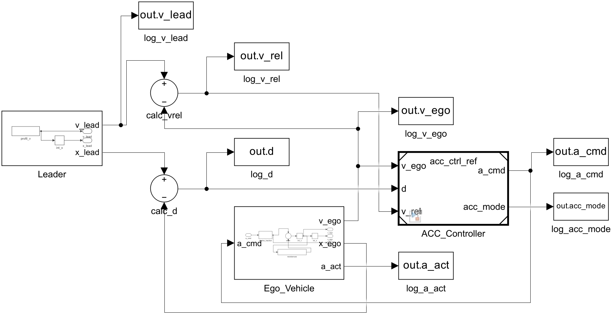
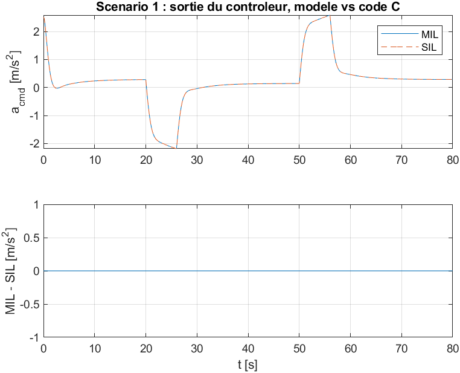
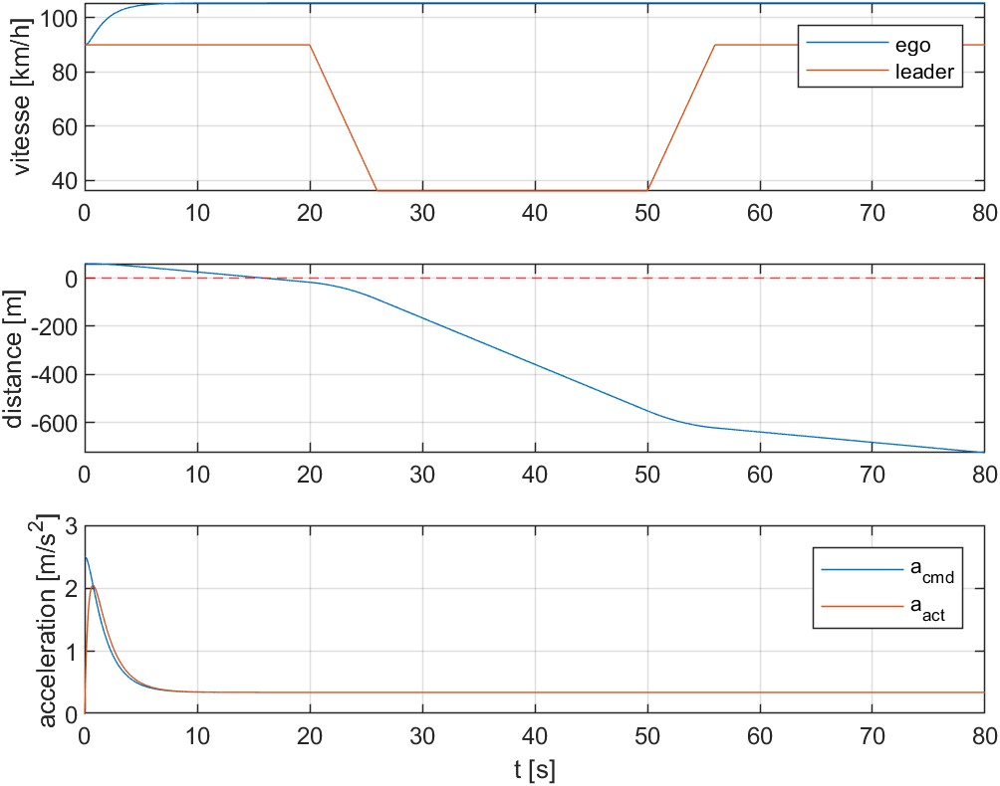

# ACC (régulateur de vitesse adaptatif) : validation MIL / SIL sous MATLAB et Simulink

Mini-projet de validation d'un contrôleur automobile. Un régulateur ACC est modélisé sous Simulink et validé en **MIL** (Model-in-the-Loop). Son code C est ensuite généré avec Embedded Coder, compilé sur PC et exécuté en **SIL** (Software-in-the-Loop) face au même modèle de véhicule. Les deux comportements sont comparés (back-to-back), puis 5 exigences de sécurité sont vérifiées automatiquement en MIL et en SIL sur 5 scénarios.

## Résultats en bref

- **Aucune collision** sur les 5 scénarios (distance minimale : 23,1 m).
- **Back-to-back MIL / SIL** : écart maximal de **0** sur l'accélération demandée, la vitesse et la distance (tolérance fixée à 1e-6), et même mode de fonctionnement du contrôleur à chaque instant.
- **5 exigences vérifiées** en MIL et en SIL : toutes satisfaites (détail plus bas).
- Code C généré : `acc_ctrl_ref.c` (127 lignes) et ses en-têtes, dans [`generated_code/`](generated_code/).

## MIL, SIL, PIL, HIL

| Niveau | Contrôleur | Véhicule | Ce que l'on valide |
|---|---|---|---|
| MIL | modèle Simulink | modèle | la logique et les gains |
| **SIL** | **code C généré, compilé sur PC** | modèle | le code généré se comporte comme le modèle |
| PIL | code C sur la vraie cible | modèle | le code sur le processeur (compilateur, ressources) |
| HIL | calculateur réel (ECU) | simulateur temps réel | l'ECU complet : entrées/sorties, temps réel |

Ce projet couvre le MIL et le SIL. Le PIL et le HIL demandent du matériel et ne sont pas traités.

## Architecture du modèle



- **Leader** : profil de vitesse imposé (table temps/vitesse), position obtenue par intégration.
- **Ego_Vehicle** : chaîne de traction du premier ordre, bilan des forces, cinématique.

  ```
  a_act = a_cmd / (tau·s + 1)                      tau = 0,3 s
  dv/dt = a_act − (½·rho·Cd·Af·v² + Crr·m·g) / m
  ```

  Paramètres : m = 1500 kg, Cd = 0,30, Af = 2,2 m², Crr = 0,012.
- **ACC_Controller** : modèle référencé `acc_ctrl_ref`, entrées `v_ego`, `d` (distance au leader) et `v_rel` (vitesse relative), sortie `a_cmd` (plus `acc_mode` pour le diagnostic). C'est ce bloc que le SIL remplace par son code C.
- Solveur à pas fixe (ode4), pas de 10 ms, identique à la période du contrôleur.

## Contrôleur

```
e_v      = v_set − v_ego
a_cruise = Kp·e_v + intégrale(Ki·e_v)                 régulation de vitesse (PI)
d_des    = d0 + th·v_ego
a_follow = Kd·(d − d_des) + Kv·v_rel                  suivi de distance
mode distance si d < 150 m et a_follow < a_cruise, sinon mode vitesse
a_cmd    = saturation(−3 ; +3 m/s²)
```

Paramètres : v_set = 30 m/s, Kp = 0,5, Ki = 0,1, d0 = 5 m, th = 1,8 s, Kd = 0,25, Kv = 0,8. L'anti-windup est une intégration conditionnelle, gelée en mode distance. Les mesures sont échantillonnées à 10 ms par des blocs Zero-Order Hold.

## Scénarios

| # | Scénario | Conditions initiales | Durée |
|---|---|---|---|
| 1 | Leader qui freine puis ré-accélère | leader 25 → 10 m/s (t = 20 à 26 s), retour à 25 m/s (t = 50 à 56 s), 60 m devant, ego à 25 m/s | 80 s |
| 2 | Route libre | leader à 33 m/s, 300 m devant (hors portée), ego à 20 m/s | 40 s |
| 3 | Véhicule lent proche | leader à 17 m/s, 35 m devant, ego à 25 m/s | 40 s |
| 4 | Leader sinusoïdal | vitesse 20 + 4·sin(2πt/20) m/s, 50 m devant, ego à 20 m/s | 80 s |
| 5 | Rattrapage d'un leader lent | leader à 20 m/s, 150 m devant, ego à 30 m/s | 60 s |

Le scénario 3 est un cut-in simplifié : le véhicule lent est déjà présent au départ, il n'apparaît pas en cours de simulation.

## Validation MIL

| # | Distance min. (m) | Écart temporel min. après 5 s (s) | a_cmd min. (m/s²) | a_cmd max. (m/s²) | Vitesse max. (m/s) |
|---|---|---|---|---|---|
| 1 | 23,6 | 1,91 | −2,19 | 2,59 | 26,6 |
| 2 | 300,0 | 11,25 | 0,26 | 3,00 | 30,7 |
| 3 | 23,1 | 1,85 | −3,00 | 0,71 | 25,0 |
| 4 | 36,8 | 2,00 | −0,90 | 2,36 | 24,1 |
| 5 | 41,9 | 2,10 | −1,44 | 0,43 | 30,0 |

Figures complètes : [scénario 1](results/mil_scenario_1.png), [2](results/mil_scenario_2.png), [3](results/mil_scenario_3.png), [4](results/mil_scenario_4.png), [5](results/mil_scenario_5.png).

Points notables :
- Scénario 2 : le correcteur PI supprime l'erreur statique, la vitesse finale est à 30 m/s près de 5·10⁻⁵ m/s. Un correcteur proportionnel seul s'arrêtait vers 29,3 m/s.
- Scénario 3 : l'accélération demandée reste saturée à −3 m/s² pendant environ 2,8 s, puis le contrôleur rétablit la distance.
- Scénario 5 : le contrôleur passe du mode vitesse au mode distance à t ≈ 6,2 s, avec un freinage doux.

## Validation SIL (back-to-back)

Pour chaque scénario, le même modèle est simulé avec le contrôleur en mode modèle (MIL), puis en mode code C compilé avec MinGW-w64 (SIL). Les signaux `a_cmd`, `v_ego` et `d` sont comparés, ainsi que le mode.

| # | écart max. `a_cmd` | écart max. `v_ego` | écart max. `d` | mode identique |
|---|---|---|---|---|
| 1 à 5 | 0 | 0 | 0 | oui |

Verdict : **réussi** (tolérance 1e-6). Détail dans [`results/sil_backtoback.csv`](results/sil_backtoback.csv).



Un écart exactement nul est attendu : le modèle et le code C effectuent les mêmes opérations en double précision.

## Exigences vérifiées automatiquement

| # | Exigence | Seuil | Résultat MIL | Résultat SIL |
|---|---|---|---|---|
| R1 | Pas de collision | d > 0 | OK (5/5) | OK (5/5) |
| R2 | Écart temporel | d / v_ego ≥ 1,5 s, après 5 s de rétablissement | OK (5/5) | OK (5/5) |
| R3 | Accélération demandée bornée | entre −3 et +3 m/s² | OK (5/5) | OK (5/5) |
| R4 | Pas de dépassement de la consigne | v_ego ≤ v_set + 1 m/s | OK (5/5) | OK (5/5) |
| R5 | Erreur statique en route libre | \|v_ego − v_set\| < 0,1 m/s | OK (scénario 2) | OK (scénario 2) |

R5 ne s'applique qu'au scénario 2, où le mode distance n'est jamais actif. Rapport complet : [`results/requirements_report.csv`](results/requirements_report.csv).

Ces seuils ont été choisis pour ce projet, après les premiers résultats MIL. Ils ne proviennent pas d'une norme. Le délai de 5 s de R2 existe parce que le scénario 3 démarre à un écart temporel de 1,4 s, déjà sous 1,5 s : il repasse au-dessus en 3,2 s.

## Banc de test validé par un contrôleur incomplet

Avant le vrai contrôleur, un régulateur de vitesse proportionnel simple, qui ignore le leader, a servi à vérifier que le banc de test détecte les défauts : erreur statique d'environ 0,7 m/s et collision avec le leader.



## Reproduire

Pré-requis : MATLAB R2024b (testé sous Windows) avec Simulink, MATLAB Coder, Simulink Coder et Embedded Coder, plus le compilateur C MinGW-w64 (add-on « MATLAB Support for MinGW-w64 C/C++/Fortran Compiler »). `mex -setup C` doit annoncer un compilateur.

```matlab
build_acc_plant        % 1. véhicule, leader et contrôleur provisoire
build_acc_controller   % 2. contrôleur ACC (PI + PD, anti-windup)
run_mil                % 3. validation MIL des 5 scénarios
run_sil                % 4. génération du code C et back-to-back MIL/SIL
run_requirements       % 5. exigences en MIL et en SIL
```

Les fichiers `acc_sil.slx` et `acc_ctrl_ref.slx` du dépôt sont l'état final, après l'étape 4. Pour rejouer la chaîne depuis zéro, supprime ces deux fichiers et le dossier `slprj/`, puis lance les cinq scripts dans l'ordre.

## Limites et pistes

- Véhicule simplifié : un seul retard du premier ordre pour la traction et le freinage, sans pente, boîte de vitesses ni glissement.
- Capteurs parfaits : pas de bruit ni de retard sur la distance mesurée.
- Cut-in statique, voir plus haut.
- SIL en double précision : il ne détecte pas les effets d'une précision finie. Piste : simple précision ou virgule fixe.
- Pas de PIL ni de HIL. Pistes : PIL sur une carte STM32, puis un HIL léger où le modèle de véhicule tourne sur PC et dialogue avec la carte.
- Pistes sur la validation : injecter volontairement un défaut dans le contrôleur pour vérifier que le back-to-back le détecte, et ajouter un vrai cut-in dynamique.
